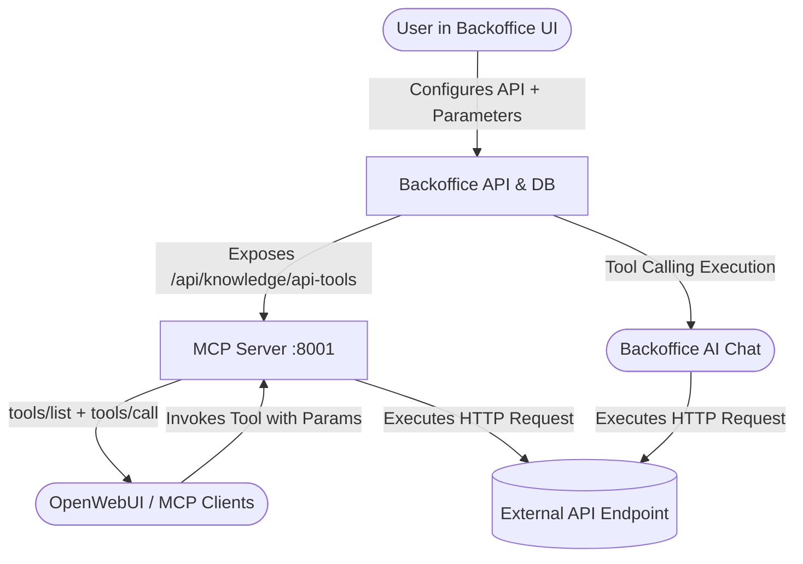

# Implementation Plan: Parameterized API Knowledge Sources as Dynamic AI Tools (MCP Tools)

Enable API Knowledge Sources to define dynamic parameters (path, query, body, header) and be automatically exposed as callable **AI Tools** via both the **MCP Server** (for OpenWebUI / Claude) and the **Backoffice AI Knowledge Chat**.

---

## User Review Required

> [!IMPORTANT]
> - **Zero Disruption to Existing Ingestion**: API sources that do not enable "AI Tool Mode" will continue to function as regular bulk-ingested knowledge sources.
> - **Dual Operation**: API sources can function purely as on-demand AI tools (no bulk vectorization required) or as hybrid sources (both indexed and callable as a live tool).
> - **OpenWebUI Compatibility**: Dynamic tools are automatically registered in `tools/list` over SSE and JSON-RPC (`/rpc`) conforming to standard Model Context Protocol (MCP) tool schemas (`inputSchema`).

---

## Proposed Changes

### 1. Backoffice API Backend (`services/backoffice_api`)

#### [MODIFY] [api_ingester.py](file:///d:/sourcecode/MCP_SERVER_IN_CEC/services/backoffice_api/services/ingestion/api_ingester.py)
- Implement `execute_tool_call(config: Dict[str, Any], arguments: Dict[str, Any]) -> Dict[str, Any]`:
  - Resolves path parameters in URL template: e.g. `/v1/users/{user_id}` replaced with argument values.
  - Injects query parameters for `in == "query"`.
  - Injects headers for `in == "header"`.
  - Injects JSON body for `in == "body"` (supporting dictionary body or templated JSON strings).
  - Handles auth token acquisition (static or OAuth2).
  - Executes asynchronous HTTP request via `httpx.AsyncClient` with timeout handling.
  - Returns structured result: `status_code`, `data` (JSON or text), `url`, `execution_time_ms`.

#### [MODIFY] [knowledge.py](file:///d:/sourcecode/MCP_SERVER_IN_CEC/services/backoffice_api/routers/knowledge.py)
- Add endpoints:
  - `GET /api/knowledge/api-tools`: Returns all active API sources configured with `is_tool=True` along with their parameter specifications and tool metadata.
  - `POST /api/knowledge/api-tools/{source_id}/test`: Accepts test parameter values, executes `execute_tool_call`, and returns the live response for UI testing.
- Adjust `create_knowledge_source` and `update_knowledge_source`:
  - If `config.get("is_tool")` is True and has required parameters, do NOT trigger bulk ingest (which would fail due to missing params); set `sync_status = "active (tool)"`.

#### [MODIFY] [chat_service.py](file:///d:/sourcecode/MCP_SERVER_IN_CEC/services/backoffice_api/services/chat_service.py)
- Integrate dynamic API tools into the Backoffice AI Knowledge Chat:
  - Formats active API tools into OpenAI/vLLM function calling schemas (`tools` parameter).
  - If the LLM generates a tool call, executes the tool via `api_ingester.execute_tool_call`, injects the result into the conversation, and generates a grounded response.
  - Returns `tools_executed` metadata in response for frontend visualization.

---

### 2. MCP Server (`services/mcp_server`)

#### [MODIFY] [main.py](file:///d:/sourcecode/MCP_SERVER_IN_CEC/services/mcp_server/main.py)
- Dynamic Tool Discovery:
  - Fetch active API tools from `http://backoffice-api:8000/api/knowledge/api-tools` (with 15s in-memory caching and fallback).
  - Translate API parameters into standard MCP `inputSchema` (JSON Schema `object`, `properties`, `required`).
- Update `/tools` and `tools/list` (JSON-RPC / SSE):
  - Returns core tools (`search_knowledge_base`, etc.) + all dynamic API tools.
- Update `execute_tool`:
  - When tool name matches an active dynamic API tool (e.g. `api_lookup_customer`):
  - Calls `api_ingester.execute_tool_call` or proxies to Backoffice API `/api/knowledge/api-tools/{id}/test`.
  - Returns formatted JSON string for OpenWebUI / Claude.

---

### 3. Backoffice UI Frontend (`services/backoffice_ui`)

#### [MODIFY] [AddApiModal.jsx](file:///d:/sourcecode/MCP_SERVER_IN_CEC/services/backoffice_ui/src/components/modals/AddApiModal.jsx)
- Add **"⚡ Enable as AI Tool (MCP Tool)"** switch with description.
- When enabled, display:
  - **Tool Name** input (alphanumeric + underscores, e.g. `get_customer_details`).
  - **Tool Description for AI** textarea (instructions describing what the tool returns and when the AI should call it).
  - **Parameter Builder Table**:
    - Add Parameter button: adds rows with:
      - `name`: Parameter identifier (e.g. `customer_id`, `status`).
      - `type`: `string`, `integer`, `number`, `boolean`.
      - `in`: `query`, `path`, `body`, `header`.
      - `description`: Text prompt describing parameter meaning for AI.
      - `required`: Boolean checkbox.
      - `default`: Optional default value.
      - Delete button (`Trash2`).
  - **Test Tool Call Drawer**:
    - Input test arguments for configured parameters and click **"Test Tool Call"**.
    - Live preview of request URL and JSON response.

#### [MODIFY] [KnowledgeSources.jsx](file:///d:/sourcecode/MCP_SERVER_IN_CEC/services/backoffice_ui/src/pages/KnowledgeSources.jsx)
- Display **"⚡ AI Tool"** badge on API source cards with tool name and parameter count.
- Add **"Test Tool"** button on the card opening a quick parameter testing modal.

#### [MODIFY] [Chat.jsx](file:///d:/sourcecode/MCP_SERVER_IN_CEC/services/backoffice_ui/src/pages/Chat.jsx)
- Display available AI Tool pills in the chat header.
- If the AI executes a tool during conversation, display an expandable **"⚡ Tool Executed: {name}"** accordion showing arguments passed and live data returned.

---

## Verification Plan

### Automated / Backend API Verification
1. Register a test API tool with query parameter (e.g. `https://httpbin.org/get` with parameter `q`).
2. Call `POST /api/knowledge/api-tools/{id}/test` with `{"q": "test1234"}`:
   - Verify `httpbin.org` received `?q=test1234` and returned `200 OK`.
3. Call `GET http://localhost:8001/tools` on MCP Server:
   - Verify dynamic tool appears with correct `parameters` schema.
4. Call `POST http://localhost:8001/call_tool` with tool name and arguments:
   - Verify MCP Server returns the API output correctly.

### AI Knowledge Chat & UI Verification
1. Open `http://localhost:5173/knowledge`.
2. Add/Edit an API Source, enable "AI Tool Mode", define parameters, and test with the built-in runner.
3. Open `http://localhost:5173/chat`.
4. Ask a question targeting the API tool parameter:
   - Verify the AI identifies the tool, invokes it with correct parameters, and references the returned data in its answer.
5. In OpenWebUI, verify the new tool is listed under MCP tools and callable during conversations.
